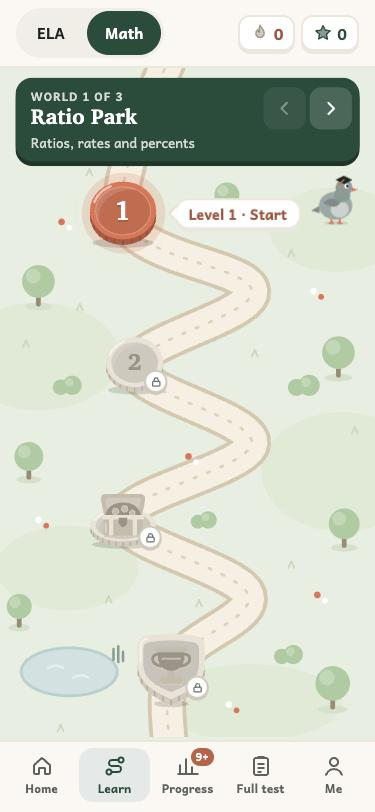
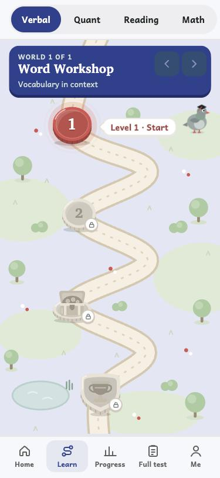
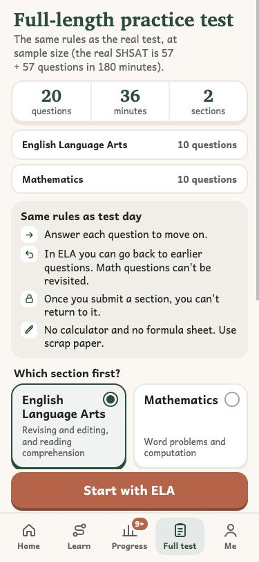
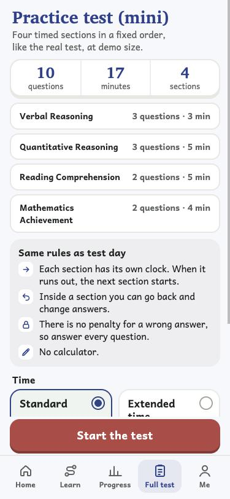

# Practice Engine

> **Tiếng Việt / người không biết code:** đọc [HUONG-DAN.md](HUONG-DAN.md) — cài đặt, đổi sang kỳ thi của bạn, đưa lên Cloudflare, từng bước.

A practice-test app for any exam. You bring a **test pack** (a config file plus your questions); the engine gives you the
whole app around it:

- a phone-first practice app with a map of short lessons (warm-up, learn card, guided steps, practice, find-the-mistake,
  boss question), XP, streaks, daily quests, badges and spaced review of mistakes;
- an adaptive tutor: placement check, unit checks with gap probes, a plan, and skills that come back when they are due;
- a timed full practice test with your exam's sections, clock rules and time options, then a score estimate on your
  exam's scale, a comparison with your benchmarks and the skills to practice next;
- parent accounts (sign-in by email code, or an optional password), up to 3 children per account with their own logins, progress synced across
  devices, and a parent report;
- an optional AI tutor ("Pip", or whatever your mascot is called): students tap preset questions, never type
  (off unless you turn it on; see [docs/pip.md](docs/pip.md));
- an admin area for problem reports, app errors and per-question statistics;
- an optional paid plan per child through Polar, with free limits and "Ask a parent for more" (off unless you turn it on);
- a landing page with SEO tags, and privacy notice and terms templates, all built from the pack;
- offline play after the first visit, and an installable app.

It runs on Cloudflare Workers with a D1 database. Building never needs a database: the pack is read from disk.

| SHSAT sample pack | ISEE demo pack |
|---|---|
|  |  |
|  |  |

Same code, two packs: different sections, timing, question types, score scale, colors and logo.

## Quickstart

You need Node 22.12 or newer.

```bash
git clone https://github.com/lythetrieu/practice-engine.git
```

```bash
cd practice-engine
```

```bash
npm install
```

```bash
npm run setup
```

`npm run setup` makes `.dev.vars` (with a new random `PASSWORD_PEPPER`) from `.dev.vars.example` and creates the local
database tables. Then:

```bash
npm run dev
```

That runs the default pack, `packs/shsat-sample`, at http://localhost:4321. The app is at `/app/`. Under `npm run dev`
you can open it as a guest; sign-in codes are printed in the terminal instead of emailed.

Pick another pack with `--pack` (a folder name under `packs/`, or a path):

```bash
npm run dev -- --pack demo-isee
```

The `PACK` environment variable works too (`PACK=demo-isee npm run dev`).

Check a pack without running anything:

```bash
npm run validate -- --pack demo-isee
```

`npm run validate -- --all` checks every pack, and `npm test` runs the validator's tests.

## Make your own pack

```bash
cp -r packs/demo-isee packs/my-exam
```

Edit `packs/my-exam/pack.yaml` (name, sections, full test, scoring, colors), `skills.yaml`, `curriculum.yaml`, and put
your questions in `packs/my-exam/questions/`. Then:

```bash
npm run dev -- --pack my-exam
```

While the dev server runs, every save in the pack folder reloads the app; a mistake shows in the terminal and in the
browser, and the last good version keeps running. [docs/authoring-a-pack.md](docs/authoring-a-pack.md) explains every
field and every question type.

Write your own questions. Do not copy or reword questions from official tests, prep books or other sites.

## What is in a pack

```
packs/my-exam/
  pack.yaml          the exam: name, sections, question types allowed, practice settings, full test, scoring,
                     test dates, tips, brand colors and logo, landing page text
  skills.yaml        skill tags, their section, and which skills each one builds on
  curriculum.yaml    the map: worlds per section, lessons per world (the skills each lesson draws on), teaching steps
  questions/*.yaml   the questions (13 types: multiple choice, multiple response, grid-in, drop-down, drag into blanks,
                     sort, put in order, tap the sentence, number line, plot points, find the mistake, table, estimate)
  passages/*.yaml    reading passages
  brand/logo.svg     the logo (also the favicon and app icon)
```

## Deploy to Cloudflare Workers and D1

You need a Cloudflare account and `npx wrangler login` once.

1. Create the database and copy the `database_id` it prints into `wrangler.jsonc` (`d1_databases`). Rename the Worker
   (`name`) and the database if you like.

   ```bash
   npx wrangler d1 create practice-engine
   ```

2. Create the tables:

   ```bash
   npm run db:migrate:remote
   ```

3. Set the password pepper (a new random string, not the one in your `.dev.vars`):

   ```bash
   npx wrangler secret put PASSWORD_PEPPER
   ```

4. Email sign-in uses Cloudflare Email Service. Onboard your sending domain in the Cloudflare dashboard (Email Service >
   Email Sending), then set `MAIL_FROM` in `wrangler.jsonc` to an address on that domain. Without it, sign-in answers
   "not set up yet" (a deployed site never prints codes to the logs).

5. Admins and the AI tutor (both optional): set `ADMIN_EMAILS` in `wrangler.jsonc`; for the tutor see
   [docs/pip.md](docs/pip.md). Fill in `legal` in `pack.yaml` for the privacy notice and terms.

6. Build with your pack and deploy:

   ```bash
   npm run build -- --pack my-exam
   ```

   ```bash
   npm run deploy
   ```

   The Astro Cloudflare adapter copies `wrangler.jsonc` into the build, so build again after you change it. One Worker
   serves one pack; to run two exams, deploy two Workers (each with its own name and database).

Optional: set `site.url` in `pack.yaml` for canonical links and the sitemap; add `routes` in `wrangler.jsonc` for your
own domain; set `TURNSTILE_SITE_KEY`, `TURNSTILE_HOSTNAMES` and the `TURNSTILE_SECRET` secret to turn on the bot check
for sign-in and reports; set `ALERT_EMAIL` to get an email when someone reports a problem.

## Payments (optional)

Off by default: no checkout, no price anywhere, no free limits. To sell one plan per child (one payment for N months,
never renews) through Polar, the merchant of record:

1. add a `plan` block to `pack.yaml` (name, months, refund days, support email, an optional `freeUntil` day, the free
   limits);
2. set `POLAR_PRODUCT_ID` and `POLAR_SERVER` in `wrangler.jsonc`, and the two secrets:

   ```bash
   npx wrangler secret put POLAR_ACCESS_TOKEN
   ```

   ```bash
   npx wrangler secret put POLAR_WEBHOOK_SECRET
   ```

3. point a Polar webhook at `https://<your site>/api/plan/webhook/`, run `npm run db:migrate:remote`, build and deploy.

Parents buy on `/account/` and come back to a thank-you screen in the app; children never see a price. Set `SITE_URL`
for links in the emails the daily cron sends. [docs/payments.md](docs/payments.md) has the steps and the rules.

## Parent password

Parents sign in with an emailed code. On `/account/` they can also add a password (10 characters or more) and then
sign in with email and password; the code always works too, and is the way back in if they forget it. Adding or
changing it needs a recent sign-in, signs out the account's other devices and sends an email. Wrong passwords get the
same answer as an unknown email, and 10 in a row pause password sign-in for that account for 15 minutes. Nothing to
set up beyond `npm run db:migrate:remote`.

## Project layout

```
packs/                 test packs (shsat-sample: 20 questions, demo-isee: 10)
src/pack/              the pack format (schema.mjs), loader and validator (load.mjs), Vite plugin (vite.mjs),
                       score estimates (scoring.ts)
src/practice/          the practice app (React): screens/, levels/ (activities and grading), tutor/ (adaptive
                       tutor), exam/ (full test: build, save, results), store.ts (progress, XP, streaks, badges)
src/lib/server/        accounts, sessions, children and their logins, progress sync, parent summary
src/pages/             landing page, /app/, /account/ (parents), /student/ (children), /admin/, /privacy/,
                       /terms/, /api/
migrations/            the D1 schema (0004 paid plan, 0005 parent password)
scripts/pack.mjs       validate / dev / build with a pack
scripts/build-sw.mjs   the offline service worker, made after each build
```

## Roles

| Role | Signs in with | Can |
|---|---|---|
| Parent | email + a 6-digit code, or email + password if they added one | add up to 3 children, make their logins, see each child's report, delete a child or the account |
| Student | username + password the parent made, or a sign-in code to scan | practice, take full tests, see only their own progress |
| Admin | a parent account whose email is in `ADMIN_EMAILS` | open `/admin/`: overview counts, problem reports (resolve/reopen), app errors, question stats |

To try the admin locally, put your parent email in `ADMIN_EMAILS` in `.dev.vars` and restart `npm run dev`. Everyone else
gets a 404 from `/admin/`. [docs/data-and-admin.md](docs/data-and-admin.md) lists every table, what it keeps, for how
long, and how to read the admin pages.

## The AI tutor (optional)

Off by default. To try it locally with a canned reply and no key, set `PIP_ENABLED=1` and `AI_TUTOR_MOCK=1` in
`.dev.vars`. To turn it on for real, set the `OPENROUTER_API_KEY` secret and `PIP_ENABLED` to `"1"` in `wrangler.jsonc`.
Name and draw your own mascot in `pack.yaml` (`mascot.name`, `mascot.image`). [docs/pip.md](docs/pip.md) covers what is
sent to the model, the models used, caps and costs.

## Children's privacy

The engine keeps a few rules on by default for apps used by children: students only tap and choose (no free-text
answers or messages), no prices on screens a child sees, an account is made only by a parent who confirms they are a
parent or guardian, and server data older than 12 months is deleted every day. `/privacy/` and `/terms/` are templates filled from
the `legal` block in `pack.yaml` and written to match what the code collects. They are a starting point, not legal
advice: have them reviewed before you go live.

## License

MIT for the engine's code: see [LICENSE](LICENSE). The sample packs' questions are original and ship under the same
license. Your own pack is yours: the license of the engine does not cover the questions you write.
